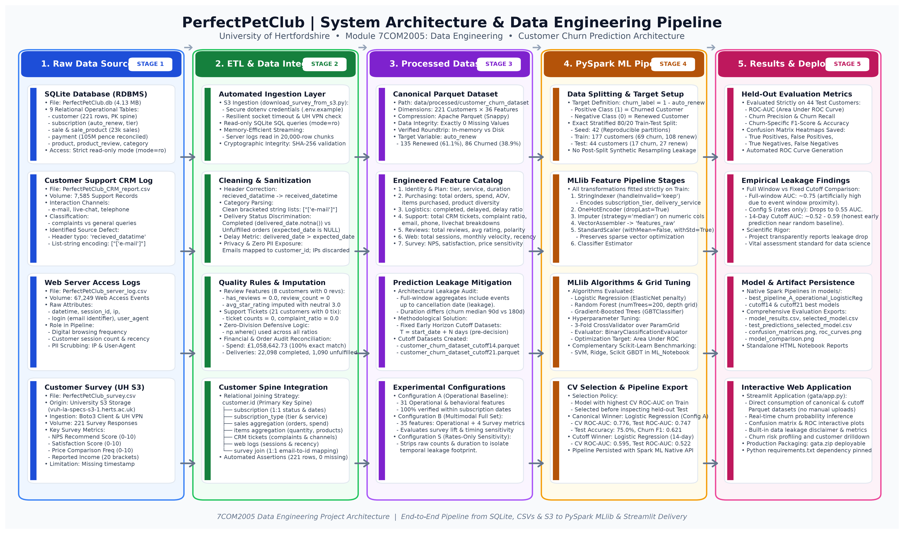

# PerfectPetClub | Technical System & Machine Learning Architecture Documentation

**Module:** 7COM2005 – Data Engineering  
**Institution:** University of Hertfordshire  
**Academic Year:** 2026/2027  
**Document Type:** Technical & System Architecture Specification  
**Project Title:** PerfectPetClub End-to-End Customer Churn Prediction Pipeline  

---

## Architecture Overview Diagram

The complete end-to-end data engineering lifecycle—spanning heterogeneous multi-source ingestion, robust data sanitization, privacy-preserving feature integration, columnar Parquet persistence, distributed PySpark MLlib modeling, temporal leakage control, and interactive web dashboard delivery—is illustrated below:



---

## 1. Project Overview

### 1.1 Purpose of PerfectPetClub
**PerfectPetClub** is a specialized subscription-based e-commerce platform offering recurring deliveries of pet supplies, specialized foods, wellness items, and subscription care boxes. The platform operates on a recurring membership model with flexible billing intervals, enabling pet owners to receive curated supplies on automated schedules while placing ad-hoc supplemental orders across an extensive product catalog.

### 1.2 The Customer Churn Prediction Problem
In recurring subscription business models, customer acquisition costs (CAC) significantly exceed retention costs. Customer churn—defined formally as a subscriber's decision not to renew their subscription agreement at the end of their subscription window (`auto_renew = 0`)—represents a direct erosion of predictable recurring revenue and customer lifetime value (LTV).

The core operational challenge is **early, accurate churn detection**:
1. **Asymmetric Cost of Misclassification**: Failing to detect a churning subscriber (False Negative) results in permanent revenue loss and forfeited lifetime value. Conversely, misidentifying a loyal customer as churn-prone (False Positive) incurs only nominal marketing retention or discount costs.
2. **Actionable Intervention Horizon**: For retention mechanisms (e.g., targeted email incentives, personalized discounts, proactive customer service outreach) to succeed, predictions must be generated with sufficient lead time *prior* to the subscription expiration date, rather than relying on signals generated during cancellation.
3. **Multimodal Customer Behavior**: Subscriber churn is driven by complex, interconnected interactions across multiple domains: financial spend, delivery delays and courier performance, support ticket complaints, post-purchase product reviews, browsing recency, and customer satisfaction sentiment.

### 1.3 Project Objectives
The engineering and analytical objectives of this project within the 7COM2005 module comprise:
* **Heterogeneous Data Ingestion**: Design and automate reproducible ingestion pipelines extracting data across disparate storage paradigms, including an operational relational database (SQLite), external support tickets (CSV), semi-structured web traffic logs (CSV), and authenticated remote cloud object storage (University of Hertfordshire S3).
* **Robust Data Sanitization & Cleaning**: Rectify raw source data anomalies (misspelled column headers, Python list-encoded strings, missing product category keys, and unfulfilled shipments) while ensuring strict read-only immutability of raw datasets.
* **Information Security & Privacy**: Enforce zero-PII exposure standards by scrubbing names, email addresses, IP addresses, and user-agent strings from analytical features, and manage remote storage credentials securely via environment isolation without repository leakage.
* **Scalable Columnar Storage**: Integrate multi-domain events into an unified, customer-level feature store persisted in Apache Parquet format with Snappy compression, validated via strict schema assertions and roundtrip readback integrity checks.
* **Scalable Distributed Machine Learning**: Implement distributed preprocessing pipelines and classification models using Apache Spark's PySpark MLlib (`LogisticRegression`, `RandomForestClassifier`, and `GBTClassifier`), optimized with 3-fold cross-validation and hyperparameter tuning on stratified splits.
* **Methodological Leakage Control**: Rigorously investigate, document, and remediate prediction-time temporal data leakage caused by whole-subscription aggregation, designing fixed-cutoff feature architectures (14-day and 21-day horizons) to establish honest, pre-decision predictive benchmarks.
* **Decision Support Delivery**: Deploy an interactive, web-based analytics dashboard using Streamlit (`gata/app.py`) to provide operations and marketing stakeholders with customer risk profiling, interactive ROC/confusion matrix inspections, and model transparency disclaimers.

---

## 2. Data Sources

The raw data sources are housed in `PerfectPetClub/data/raw/` and represent four distinct operational systems.

| Data Source | System Type | Storage Format | Raw Record Count | File Size | Primary Key / Entity |
|---|---|---|---|---|---|
| **`PerfectPetClub.db`** | Operational RDBMS | SQLite 3 Database | 9 tables (see breakdown) | 4.13 MB | `customer.id` |
| **`PerfectPetClub_CRM_report.csv`** | Support Ticketing System | Flat CSV File | 7,585 support tickets | 359 KB | `customer_id` |
| **`PerfectPetClub_server_log.csv`** | Web Server Access Logs | Flat CSV File | 67,249 web hits | 12.00 MB | `login` (email) |
| **`PerfectPetClub_survey.csv`** | Remote Object Storage (S3) | Flat CSV File | 221 survey records | 8.6 KB | `email` |

```
                                  DATA SOURCES RELATIONSHIP MAP

   +-----------------------------------------------------------------------------------+
   |                                 PerfectPetClub.db                                 |
   |                                                                                   |
   |   +-------------------+         1:1         +---------------------------------+   |
   |   |     customer      | <-----------------> |          subscription           |   |
   |   |   (221 records)   |                     |          (221 records)          |   |
   |   +-------------------+                     | Target: auto_renew (0 / 1)      |   |
   |      |             |                        +---------------------------------+   |
   |      |             |                                         | N:1                |
   |      | 1:N         | 1:N                                     v                    |
   |      |             |                        +---------------------------------+   |
   |      |             |                        |        subscription_type        |   |
   |      |             |                        |           (3 records)           |   |
   |      |             |                        +---------------------------------+   |
   |      |             |                                                              |
   |      |             v                                                              |
   |      |    +-------------------+         N:1         +-------------------------+   |
   |      |    |       sale        | ------------------> |         payment         |   |
   |      |    |  (23,188 orders)  |                     |  (105,864,273 pence)    |   |
   |      |    +-------------------+                     +-------------------------+   |
   |      |             |                                                              |
   |      |             | 1:N                                                          |
   |      |             v                                                              |
   |      |    +-------------------+         N:1         +-------------------------+   |
   |      |    |   sale_product    | ------------------> |         product         |   |
   |      |    | (59,759 items)    |                     |     (1,000 items)       |   |
   |      |    +-------------------+                     +-------------------------+   |
   |      |                                                           | N:1            |
   |      v                                                           v                |
   |   +-------------------+                             +-------------------------+   |
   |   |  product_review   |                             |    product_category     |   |
   |   | (10,990 reviews)  |                             |      (26 categories)    |   |
   |   +-------------------+                             +-------------------------+   |
   +-----------------------------------------------------------------------------------+
          ^ (customer_id)               ^ (login -> email)            ^ (email)
          |                             |                             |
   +--------------------+      +--------------------+      +--------------------+
   |   CRM Report CSV   |      |   Server Log CSV   |      |  Survey (UH S3)    |
   |   (7,585 tickets)  |      |  (67,249 web hits) |      |   (221 responses)  |
   +--------------------+      +--------------------+      +--------------------+
```

### 2.1 SQLite Operational Database (`PerfectPetClub.db`)
The relational database reflects the transactional core of the business across 9 interconnected tables:
1. **`customer` (221 rows)**: Master subscriber entity containing `id` (integer primary key), `first_name`, `last_name`, `email`, and `subscription_id` (foreign key to `subscription.id`).
2. **`subscription` (221 rows)**: Defines the subscription lifecycle, including `id`, `start_date`, `end_date`, `auto_renew` (integer: `1` for renewed, `0` for churned), and `subscription_type_id`.
3. **`subscription_type` (3 rows)**: Service tier metadata (`Basic`, `SuperSaver`, and `Premium`) and assigned delivery couriers (`Royal Mail`, `Evri`, and `DPD`).
4. **`sale` (23,188 rows)**: Order transactions containing `id`, `customer_id`, `order_date`, `expected_date`, `delivered_date`, and `payment_id`.
5. **`sale_product` (59,759 rows)**: Line-item product purchases mapping `sale_id`, `product_id`, and item `quantity`.
6. **`payment` (23,188 rows)**: Billing transaction table storing monetary values in integer pence (`amount`).
7. **`product` (1,000 rows)**: Master product catalog specifying `id`, `name`, `price`, and `product_category_id`.
8. **`product_category` (26 rows)**: Classification categories for pet supplies, dietary products, and accessories.
9. **`product_review` (10,990 rows)**: Customer product evaluations detailing `id`, `customer_id`, `product_id`, `sale_id`, and `star_rating` (integer 1 to 5). Notably, review records omit date timestamps.

### 2.2 Customer Support CRM Log (`PerfectPetClub_CRM_report.csv`)
This source captures customer service touchpoints logged by support representatives:
* **Volume**: 7,585 interaction records.
* **Attributes**: `customer_id` (foreign key), `recieved_datatime` (ISO timestamp), `platform` (communication channel), and `type` (nature of contact).
* **Communication Channels**: Categorized across `e-mail`, `live-chat`, and `telephone`.
* **Interaction Types**: Segmented into operational inquiries (`query`) and customer dissatisfaction events (`complaint`).
* **Contribution**: Enables quantifying customer support friction, complaint severity, and preferred communication channels.

### 2.3 Web Server Access Logs (`PerfectPetClub_server_log.csv`)
Web server traffic logging user interactions on the PerfectPetClub web application:
* **Volume**: 67,249 web access hits.
* **Attributes**: `datetime` (access timestamp), `session_id` (session hash), `ip` (client IP address), `login` (authenticated user email address), and `user_agent` (client browser string).
* **Contribution**: Measures subscriber digital engagement, site visit frequency, browsing velocity, and recency of last login prior to the renewal decision.

### 2.4 Customer Survey Dataset (`PerfectPetClub_survey.csv`)
Customer satisfaction survey capturing self-reported customer sentiment:
* **Origin**: University of Hertfordshire private cloud object storage (`http://vuh-la-specs-s3-1.herts.ac.uk:9000`, bucket: `comsci-student-s3-1`), ingested automatically via `PerfectPetClub/scripts/download_survey_from_s3.py`.
* **Volume**: Exactly 221 records, matching 100% of the active customer database.
* **Attributes**: `email` (matching key), `reported_income` (20 categorical income brackets, e.g., `34k-38k`), `nps_recommend` (Net Promoter Score rating 0–10), `satisfaction_score` (overall satisfaction rating 0–10), and `online_comparison_freq` (competitor comparison frequency rating 0–10).
* **Contribution**: Provides explicit psychological sentiment and price sensitivity indicators.
* **Key Limitation**: Contains no collection timestamp, meaning survey responses cannot be verifiably placed before the customer's churn decision point.

---

## 3. System Architecture

The data engineering architecture follows an enterprise-standard **Extract, Transform, and Load (ETL)** pattern, producing an immutable, high-performance feature store.

```
                                  SYSTEM ETL ARCHITECTURE

 +--------------------+   +--------------------+   +--------------------+   +--------------------+
 | SQLite Operational |   | CRM Tickets Report |   | Web Access Logs    |   | S3 Customer Survey |
 | PerfectPetClub.db  |   | .csv (7,585 rows)  |   | .csv (67,249 rows) |   | .csv via Boto3 SDK |
 +--------------------+   +--------------------+   +--------------------+   +--------------------+
           |                         |                        |                        |
           v                         v                        v                        v
 [ Read-only SQL URI ]    [ In-Memory Parse ]     [ 20k Chunk Stream ]     [ Dotenv Auth & VPN ]
           |                         |                        |                        |
           +-------------------------+------------+-----------+------------------------+
                                                  |
                                                  v
                              +---------------------------------------+
                              |      DATA CLEANING & RECTIFICATION    |
                              |---------------------------------------|
                              | • Typo: recieved_datatime -> received |
                              | • Strip Python string lists: ['email']|
                              | • PII scrubbed: IP, agent, raw emails |
                              | • Deliveries: completed vs unfulfilled|
                              | • Delays: delivered_date > expected   |
                              | • Zero-division guards: np.where()    |
                              +---------------------------------------+
                                                  |
                                                  v
                              +---------------------------------------+
                              |     CUSTOMER-SPINE INTEGRATION        |
                              |---------------------------------------|
                              | Primary Key Spine: customer.id (221)  |
                              | • Merge subscription & tier metadata  |
                              | • Aggregate 23,188 sales & payments   |
                              | • Aggregate 7,585 CRM ticket counts   |
                              | • Aggregate 67,249 web log sessions   |
                              | • Left-join 221 survey responses      |
                              +---------------------------------------+
                                                  |
                                                  v
                              +---------------------------------------+
                              |      QUALITY ASSURANCE & AUDIT        |
                              |---------------------------------------|
                              | • Assert: row count == 221            |
                              | • Assert: unique customer_id == 221   |
                              | • Assert: missing values == 0         |
                              | • Financial audit: £1,058,642.73      |
                              | • Roundtrip readback verification     |
                              +---------------------------------------+
                                                  |
                                                  v
                              +---------------------------------------+
                              |      COLUMNAR PARQUET ARTIFACTS       |
                              |---------------------------------------|
                              | Canonical: customer_churn_dataset     |
                              | Cutoff-14: customer_churn_cutoff14    |
                              | Cutoff-21: customer_churn_cutoff21    |
                              +---------------------------------------+
```

### 3.1 Extraction Pipeline
1. **Relational Database Extraction**:
   - Automated via `extract_database_tables()` in `PerfectPetClub/notebooks/01_ETL_Pipeline.ipynb`.
   - Utilizes SQLite read-only URI connections (`file:<path>?mode=ro`) to prevent write locks or accidental modifications to raw operational records.
2. **Streaming Chunked Extraction for Large CSVs**:
   - The 12 MB web server access log (67,249 rows) is ingested via `pd.read_csv(..., chunksize=20000)` streaming iterators.
   - Immediate in-flight transformation maps raw `login` emails to integer `customer_id` keys, selectively loading only relevant columns (`datetime`, `session_id`, `customer_id`) and discarding high-cardinality IP addresses and client user-agent strings.
3. **Automated Remote S3 Downloader**:
   - Implemented in `PerfectPetClub/scripts/download_survey_from_s3.py`.
   - Uses `boto3` client parameterized dynamically with environment variables (`UH_S3_ACCESS_KEY`, `UH_S3_SECRET_KEY`, `UH_S3_ENDPOINT_URL`, `UH_S3_BUCKET_NAME`).
   - Implements connection timeout configurations (5s connect, 15s read), diagnostic error handling for UH VPN connectivity, and cryptographic SHA-256 hash validation.
   - Excludes sensitive credentials from version control via `.gitignore` and `.env.example`.

### 3.2 Data Cleaning and Preprocessing
The pipeline systematically handles data anomalies identified during initial schema inspection:
* **Header Typo Rectification**: The misspelled column `recieved_datatime` in `PerfectPetClub_CRM_report.csv` is mapped to `received_datetime` in memory while leaving the raw CSV unaltered.
* **Stringified List Normalization**: CRM platform values formatted as serialized Python lists (e.g., `"['e-mail']"`) are cleaned using string stripping (`.str.strip("[]'\" ")`) into standardized strings (`"e-mail"`, `"telephone"`, `"live-chat"`).
* **Delivery Status Partitioning**: Sales orders are partitioned into completed shipments (`delivered_date.notna()`) and unfulfilled/pending orders (`delivered_date.isna()`). Delivery delay hours are computed strictly for completed orders where `delivered_date > expected_date`.
* **Zero-Division Defensive Guards**: All engineered rate metrics (e.g., `avg_order_value_pence`, `delivery_delay_ratio`, `crm_complaint_ratio`, `order_frequency_per_month`) implement conditional evaluation (`np.where()`) to prevent `NaN` or `Inf` artifacts when order or ticket counts are zero.
* **Missing Value Imputation**:
  - Support Tickets: 21 customers with zero CRM tickets are assigned `0` for ticket counts and `0.0` for complaint ratio.
  - Product Reviews: 8 customers who submitted no reviews are assigned `0` for review counts, `has_reviews = 0.0`, and neutral median star rating `3.0`.
  - Survey Attributes: Exactly 0 missing values across all 221 respondents.
  - Output Dataset Completeness: Exactly **0 missing values** across all 36 columns.

### 3.3 Dataset Integration Strategy
Integration is orchestrated around the customer entity spine:
1. **Primary Spine**: Table `customer` is inner-joined to `subscription` on `customer.subscription_id = subscription.id`, and then joined to `subscription_type` on `subscription.subscription_type_id = subscription_type.id`.
2. **Temporal Window Definition**: Subscription active duration is computed as `duration_days = (end_date - start_date).dt.days`.
3. **Identity Resolution**: An in-memory mapping dictionary (`email_to_id = dict(zip(customer.email, customer.id))`) provides cross-source joins for the web server log and customer survey without leaking plain-text email identifiers into the final dataset.
4. **Aggregated Feature Groupings**:
   - `sale` + `payment`: Grouped by `customer_id` to compute monetary totals, mean order value, order counts, and delivery metrics.
   - `sale_product`: Merged with `sale` and grouped by `customer_id` to compute total items purchased and catalog diversity (`nunique()`).
   - `CRM_report`: Aggregated per `customer_id` across total tickets, complaint count, inquiry count, and channel-specific frequencies.
   - `server_log`: Grouped per `customer_id` to compute total sessions, latest visit date, and monthly session velocity.
   - `survey`: Left-joined on `customer_id` to attach self-reported NPS, satisfaction, income, and price comparison metrics.

### 3.4 Creation and Validation of Processed Parquet Datasets
The unified dataset is exported to Apache Parquet format at `PerfectPetClub/data/processed/customer_churn_dataset.parquet`.

**Storage Advantages of Apache Parquet:**
* **Columnar Layout**: Optimizes storage efficiency and enables column projection, allowing PySpark MLlib to read only the required feature subsets during model training.
* **Snappy Compression**: Minimizes disk footprint while delivering ultra-fast decompression throughput for distributed computing.
* **Embedded Schema Metadata**: Preserves explicit data types (`int64`, `float64`, `string`) across storage and execution boundaries, preventing type-inference discrepancies.

**Validation and Financial Audit:**
* **Schema Integrity Assertions**: The pipeline asserts that total rows equal 221, unique customer IDs equal 221, duplicate rows equal 0, missing values equal 0, and target nulls equal 0.
* **Financial Reconciliation Audit**:
  - Sum of `total_spend_pence` across all 221 customers in Parquet: **105,864,273 pence (£1,058,642.73)**.
  - Sum of `amount` in SQLite operational `payment` table: **105,864,273 pence (£1,058,642.73)**.
  - Discrepancy: **£0.00 (100% exact reconciliation)**.
* **Operational Count Reconciliation**: Total completed deliveries (22,098) plus unfulfilled deliveries (1,090) sum to exactly 23,188, matching the SQLite `sale` table. CRM tickets sum to exactly 7,585.
* **Roundtrip Fidelity**: The Parquet file is re-read from disk and confirmed identical in shape, values, and column ordering to the in-memory DataFrame.

### 3.5 The Processed Feature Catalog (36 Attributes)

```
+--------------------------------------------------------------------------------------------------+
|                                  ENGINEERED FEATURE CATALOG (36)                                 |
+--------------------------------------------------------------------------------------------------+
| 1. Identifiers & Target (5)     | customer_id (PK), subscription_tier, delivery_service,         |
|                                 | duration_days, auto_renew (Supervised Target: 1=Renew, 0=Churn)|
|---------------------------------+----------------------------------------------------------------|
| 2. Purchasing Behaviour (6)     | total_orders, total_spend_pence, avg_order_value_pence,        |
|                                 | total_items_purchased, unique_products_purchased,              |
|                                 | avg_items_per_order                                            |
|---------------------------------+----------------------------------------------------------------|
| 3. Logistics & Delivery (5)     | completed_deliveries, unfulfilled_orders, delayed_deliveries,   |
|                                 | avg_delivery_delay_hours, delivery_delay_ratio                  |
|---------------------------------+----------------------------------------------------------------|
| 4. Customer Support / CRM (7)   | total_crm_interactions, crm_complaints_count,                  |
|                                 | crm_queries_count, crm_email_count, crm_phone_count,           |
|                                 | crm_livechat_count, crm_complaint_ratio                        |
|---------------------------------+----------------------------------------------------------------|
| 5. Product Reviews (5)          | total_reviews, avg_star_rating, low_star_reviews_count,        |
|                                 | high_star_reviews_count, has_reviews                           |
|---------------------------------+----------------------------------------------------------------|
| 6. Web Engagement (4)           | total_web_sessions, days_since_last_session,                   |
|                                 | session_frequency_per_month, order_frequency_per_month          |
|---------------------------------+----------------------------------------------------------------|
| 7. Survey & Sentiment (4)       | reported_income (categorical bracket), nps_recommend (0-10),   |
|                                 | satisfaction_score (0-10), online_comparison_freq (0-10)       |
+--------------------------------------------------------------------------------------------------+
```

---

## 4. Machine Learning Architecture

The modeling architecture is designed and executed using Apache Spark's **PySpark MLlib** distributed framework (`pyspark.ml`).

```
                              PYSPARK MLLIB PIPELINE ARCHITECTURE

   +-----------------------------------------------------------------------------------+
   |                               PARQUET FEATURE INPUT                               |
   |             (e.g., customer_churn_dataset.parquet: 221 rows x 36 cols)            |
   +-----------------------------------------------------------------------------------+
                                            |
                                            v
   +-----------------------------------------------------------------------------------+
   |                    TARGET ENCODING & STRATIFIED TRAIN/TEST SPLIT                  |
   | • Target: churn_label = 1 - auto_renew (1 = Churned Positive, 0 = Renewed Negative)|
   | • Stratified Split (Seed 42): Train = 80% (177 rows), Test = 20% (44 rows)        |
   +-----------------------------------------------------------------------------------+
                                            |
                         (Fitted strictly on Training Split)
                                            |
                                            v
   +-----------------------------------------------------------------------------------+
   |                                PREPROCESSING PIPELINE                             |
   |                                                                                   |
   |   [ Categorical Features ]                       [ Numerical Features ]           |
   |              |                                              |                     |
   |              v                                              v                     |
   |    StringIndexer(handleInvalid="keep")           Imputer(strategy="median")       |
   |              |                                              |                     |
   |              v                                              |                     |
   |    OneHotEncoder(dropLast=True)                             |                     |
   |              |                                              |                     |
   |              +----------------------+-----------------------+                     |
   |                                     |                                             |
   |                                     v                                             |
   |                      VectorAssembler (features_raw)                               |
   |                                     |                                             |
   |                                     v                                             |
   |              StandardScaler(withMean=False, withStd=True)                         |
   |                                     |                                             |
   |                                     v                                             |
   |                         Standardized Vector: features                             |
   +-----------------------------------------------------------------------------------+
                                            |
                                            v
   +-----------------------------------------------------------------------------------+
   |                    DISTRIBUTED CLASSIFIERS & HYPERPARAMETER GRIDS                 |
   |                                                                                   |
   |   • Logistic Regression       • Random Forest             • Gradient-Boosted Trees|
   |     regParam: [0.01, 0.1, 1]    numTrees: 200               maxDepth: [2, 3]      |
   |     elasticNetParam: [0, 0.5]   maxDepth: [3, 5]            maxIter: [20, 50]     |
   |                                 minInstancesPerNode: [1, 5]                       |
   +-----------------------------------------------------------------------------------+
                                            |
                                            v
   +-----------------------------------------------------------------------------------+
   |                       3-FOLD CROSS-VALIDATION (ON TRAINING SET)                   |
   |        Maximizing Area Under ROC via BinaryClassificationEvaluator                |
   +-----------------------------------------------------------------------------------+
                                            |
                                            v
   +-----------------------------------------------------------------------------------+
   |                            HELD-OUT EVALUATION (44 TEST ROWS)                     |
   | • ROC-AUC  • Churn F1  • Churn Precision  • Churn Recall  • Confusion Matrix Heatmap|
   +-----------------------------------------------------------------------------------+
```

### 4.1 PySpark Pipeline Components
To guarantee zero preprocessing leakage between training and testing partitions, all transformation and scaling stages are encapsulated within a unified PySpark `Pipeline`:
1. **`StringIndexer`**: Encodes categorical string attributes (`subscription_tier`, `delivery_service`, `reported_income`) into numerical index columns. Configured with `handleInvalid="keep"` to ensure unseen categories in held-out sets are assigned a designated category bucket rather than raising runtime errors.
2. **`OneHotEncoder`**: Converts indexed categorical columns into sparse binary vectors (`dropLast=True`) to remove collinearity.
3. **`Imputer`**: Computes median statistics across numerical features derived strictly from the training split and applies imputation to any missing elements.
4. **`VectorAssembler`**: Concatenates imputed numerical vectors and one-hot encoded categorical vectors into a single feature vector (`features_raw`).
5. **`StandardScaler`**: Scales continuous features to unit standard deviation (`withStd=True`). Crucially, `withMean=False` is enforced because centering sparse vectors would convert them to dense representations, causing excessive memory consumption and performance bottlenecks in Apache Spark.
6. **Classifier Estimator**: Placed as the final stage of the pipeline.

### 4.2 Supervised Learning Classifiers
Three supervised machine learning algorithms from PySpark MLlib were trained and tuned:
* **Logistic Regression (`LogisticRegression`)**: Linear classification boundary trained with ElasticNet regularization (`regParam` controlling regularization strength, `elasticNetParam` balancing L1 Lasso and L2 Ridge penalties).
* **Random Forest (`RandomForestClassifier`)**: Ensemble of bagging decision trees (`numTrees=200`). Evaluated across tree depths (`maxDepth` ∈ {3, 5}) and minimum instances per leaf node (`minInstancesPerNode` ∈ {1, 5}).
* **Gradient-Boosted Trees (`GBTClassifier` / Decision Trees)**: Iterative boosting ensemble optimizing pseudo-residuals of decision trees. Evaluated across depths (`maxDepth` ∈ {2, 3}) and iterations (`maxIter` ∈ {20, 50}).

*Note on Repository Scikit-Learn Models*: In addition to the primary PySpark MLlib pipeline, the repository maintains exploratory and deployment models implemented in Scikit-Learn within `ML_Notebook/data_eng.ipynb` and `Updated_ML_Models/Machine Learning model updated.ipynb` (serialized as `.pkl` files including SVM, Gradient Boosting, Ridge Classifier, and Random Forest).

### 4.3 Training, Split & Model Selection Strategy
* **Target Label Definition**: Formulated as `churn_label = 1 - auto_renew`. The positive class (`1`) corresponds to churned customers, while the negative class (`0`) corresponds to renewing customers. All precision, recall, and F1-score metrics are evaluated with respect to the churn class.
* **Exact Stratified 80/20 Split**: Seeded with `seed=42`, dividing the 221 records into:
  - **Training Split**: 177 subscribers (108 Renewed, 69 Churned).
  - **Testing Split**: 44 subscribers (27 Renewed, 17 Churned).
  - Stratification maintains the ~61% renewed / ~39% churned distribution across partitions.
* **Model Selection**: Conducted via 3-fold `CrossValidator` across a parameter grid generated by `ParamGridBuilder`. Optimization is driven by `BinaryClassificationEvaluator(metricName="areaUnderROC")`. The final model is selected based on highest cross-validated training ROC-AUC *before* evaluating the held-out test set.

### 4.4 Experimental Configurations & Ablation Testing
To assess the impact of external survey indicators and investigate temporal data leakage, modeling is executed across three experimental configurations:
* **Configuration A (Operational Baseline - 31 features)**: Uses strictly transactional, operational, logistics, CRM, review, and web engagement features.
* **Configuration B (Multimodal Full Feature Set - 35 features)**: Combines all 31 operational features with the 4 self-reported customer survey attributes (`reported_income`, `nps_recommend`, `satisfaction_score`, `online_comparison_freq`).
* **Configuration S (Rates-Only Sensitivity - 27 features)**: Strips raw cumulative totals (e.g., `total_spend_pence`, `total_orders`, `completed_deliveries`) and `duration_days`, retaining only normalized velocity metrics (orders per month, sessions per month, delay ratios).

### 4.5 Empirical Evaluation Results (Canonical Full-Window Parquet)
The model performance on the held-out test split (44 customers) across all configurations from `PerfectPetClub/outputs/ml/model_results.csv`:

| Configuration | Model Algorithm | CV ROC-AUC | Best Hyperparameters | Test Accuracy | Churn Precision | Churn Recall | Churn F1 | Test ROC-AUC | Confusion Matrix (TN, FP, FN, TP) |
|---|---|---|---|---|---|---|---|---|---|
| **A (Operational)** | **Logistic Regression** | **0.7759** | `regParam=0.1, elasticNetParam=0.5` | **0.7500** | **0.7500** | **0.5294** | **0.6207** | **0.7473** | [24, 3, 8, 9] |
| **A (Operational)** | Random Forest | 0.7167 | `maxDepth=5, minInstances=1` | 0.6364 | 0.5556 | 0.2941 | 0.3846 | 0.7168 | [23, 4, 12, 5] |
| **A (Operational)** | GBTClassifier | 0.7070 | `maxDepth=2, maxIter=20` | 0.6591 | 0.5556 | 0.5882 | 0.5714 | 0.6754 | [19, 8, 7, 10] |
| **B (Multimodal)** | **Logistic Regression** | **0.7668** | `regParam=0.1, elasticNetParam=0.5` | **0.7273** | **0.6923** | **0.5294** | **0.6000** | **0.7386** | [23, 4, 8, 9] |
| **B (Multimodal)** | Random Forest | 0.7108 | `maxDepth=5, minInstances=1` | 0.6591 | 0.6250 | 0.2941 | 0.4000 | 0.7298 | [24, 3, 12, 5] |
| **B (Multimodal)** | GBTClassifier | 0.6965 | `maxDepth=2, maxIter=50` | 0.6591 | 0.5556 | 0.5882 | 0.5714 | 0.7342 | [19, 8, 7, 10] |
| **S (Rates-Only)** | Logistic Regression | 0.6221 | `regParam=1.0, elasticNetParam=0.0` | 0.5909 | 0.0000 | 0.0000 | 0.0000 | 0.5512 | [26, 1, 17, 0] |
| **S (Rates-Only)** | Random Forest | 0.6426 | `maxDepth=3, minInstances=5` | 0.6364 | 0.6000 | 0.1765 | 0.2727 | 0.5643 | [25, 2, 14, 3] |
| **S (Rates-Only)** | GBTClassifier | 0.6192 | `maxDepth=3, maxIter=20` | 0.6136 | 0.5000 | 0.3529 | 0.4138 | 0.5763 | [21, 6, 11, 6] |

### 4.6 Investigation and Resolution of Prediction-Time Leakage
A critical finding documented in `PerfectPetClub/documentation/fixed_cutoff_feature_design.md` and `PerfectPetClub/notebooks/02_Machine_Learning.ipynb` is that the canonical full-window features suffer from **prediction-time target leakage**:
1. **The Root Cause**: Features in the canonical dataset are aggregated over the entire subscription window (`start_date` to `end_date`). For churning subscribers (`auto_renew = 0`), `end_date` is the cancellation date. Consequently, their active windows are substantially shorter (median 90 days vs 180 days for renewed subscribers).
2. **Artificial Predictability**: Count and spend features (`total_orders`, `total_spend_pence`) are lower for churned customers *by construction* simply because their observation window was prematurely terminated by the churn event itself. Furthermore, 17.7% of churned customers' orders occur within their final 30 days before cancellation.
3. **The Empirical Proof**: In Configuration S, when raw duration and totals are removed and only normalized rates are retained, test ROC-AUC collapses from 0.747 to **0.551** (near random chance).

**The Architectural Remedy: Fixed-Cutoff Horizon Datasets**
To establish valid prediction benchmarks that forecast churn *before* the decision point, fixed early horizon datasets were engineered:
* **Option B (Fixed Horizon: $T = \text{start\_date} + N \text{ days}$)**: Events are filtered such that only records occurring within the first $N$ days of a subscription are ingested.
* **Cutoff 14-Day Horizon (`customer_churn_dataset_cutoff14.parquet`)**: Evaluated in `03_Fixed_Cutoff_Features.ipynb` and `04_Cutoff_Machine_Learning.ipynb`. Because the shortest subscription tenure in the repository is 30 days, a 14-day cutoff ensures at least a 16-day pre-decision buffer for every customer.
* **Cutoff 21-Day Horizon (`customer_churn_dataset_cutoff21.parquet`)**: Evaluated in `05_Cutoff21_Features.ipynb` and `06_Cutoff21_Machine_Learning.ipynb`.

**Empirical Results Under Fixed Cutoffs:**
* Under 14-day cutoff: Test ROC-AUC drops to **0.5218** (Logistic Regression) and **0.5468** (Random Forest).
* Under 21-day cutoff: Test ROC-AUC ranges between **0.5338** and **0.5817**.
* **Academic Significance**: This transparent, empirical demonstration of performance drop under strict leakage control exemplifies rigorous data engineering practice, proving that apparent full-window predictive power was largely an artifact of outcome-proximate observation windows.

---

## 5. Technology Stack

The technologies and libraries utilized throughout the repository comprise:

| Layer / Domain | Technology | Version / Scope | Role in PerfectPetClub Project |
|---|---|---|---|
| **Core Language** | **Python** | 3.11 / 3.12 / 3.14 | Primary programming language across notebooks, ETL scripts, and web services. |
| **Distributed Big Data** | **Apache Spark** | 4.3.0 | Distributed cluster compute engine providing resilient distributed data structures. |
| **Distributed ML** | **PySpark MLlib** | 4.x (`pyspark.ml`) | Distributed feature transformers (`VectorAssembler`, `OneHotEncoder`, `StandardScaler`) and classifiers (`LogisticRegression`, `RandomForestClassifier`, `GBTClassifier`). |
| **Data Manipulation** | **Pandas** | >= 2.2.0, < 3.0.0 | Tabular data transformations, aggregation logic, rolling metrics, and ETL orchestration. |
| **Numerical Computing** | **NumPy** | >= 1.26.0 | Array manipulation, conditional zero-division safeguards (`np.where()`, `np.maximum()`). |
| **Relational Database** | **SQLite 3** | Built-in | Operational transactional storage (`PerfectPetClub.db`) accessed via Python `sqlite3` using read-only URIs (`mode=ro`). |
| **Analytical Storage** | **Apache Parquet** | PyArrow >= 15.0.0 | Columnar file persistence with Snappy compression for canonical and cutoff feature stores. |
| **Cloud Object Storage** | **Boto3 (AWS SDK)** | Standard | Secure automated S3 ingestion client communicating with the UH MinIO/S3 endpoint. |
| **Traditional ML** | **Scikit-Learn** | >= 1.4.0 | Evaluation metrics, confusion matrices, and complementary exploratory models (`ML_Notebook`, `Updated_ML_Models`). |
| **Model Persistence** | **Spark Native / Joblib / Pickle** | Native Spark ML | Native MLlib pipeline serialization (`models/best_pipeline_...`) and Scikit-Learn `.pkl` persistence. |
| **Visualization** | **Matplotlib & Seaborn** | Matplotlib >= 3.8, Seaborn >= 0.13 | Evaluation charts, ROC curves, confusion matrix heatmaps, and architecture diagrams. |
| **Web Deployment** | **Streamlit** | Standard | Interactive web dashboard (`gata/app.py`) for operational churn scoring and risk segmentation. |
| **Environment & Security** | **python-dotenv** | >= 1.0.0 | Dynamic runtime injection of S3 access credentials without repository exposure. |
| **Development & VCS** | **Jupyter Notebook & Git / GitHub** | Standard | Reproducible experiment notebooks, branching workflows, PR peer reviews, and version tracking. |

---

## 6. End-to-End Data Flow

The complete data lifecycle follows an uninterrupted progression across nine distinct phases:

```
  +-----------------------------------------------------------------------------------------------------------------------+
  |                                                  END-TO-END DATA FLOW                                                 |
  +-----------------------------------------------------------------------------------------------------------------------+
  
   [Phase 1: Raw Operational Sources]
        │  • SQLite: customer, subscription, sale, payment, product, review
        │  • CSVs: CRM tickets, Web server logs, Customer survey (UH S3)
        ▼
   [Phase 2: Ingestion & Extraction]
        │  • Read-only SQLite SQL queries
        │  • Streaming 20k chunk reads on server log CSV
        │  • Boto3 client fetching survey CSV via UH VPN
        ▼
   [Phase 3: Data Cleaning & Rectification]
        │  • Typo correction: recieved_datatime -> received_datetime
        │  • Strip serialized list brackets from CRM platform
        │  • Partition completed deliveries vs unfulfilled orders
        │  • Scrub PII: drop raw emails, IP addresses, and user-agents
        ▼
   [Phase 4: Customer-Spine Integration]
        │  • Join customer PK spine to subscription and subscription_type
        │  • Map email to customer_id for logs and survey joins
        │  • Aggregate transactions, line-item quantities, and ticket volumes
        │  • Defensive imputation: neutral 3.0 star rating for unreviewed customers
        ▼
   [Phase 5: Analytical Parquet Feature Store]
        │  • Canonical export: customer_churn_dataset.parquet (221 rows x 36 cols)
        │  • Cutoff exports: customer_churn_dataset_cutoff14.parquet & cutoff21
        │  • Zero missing values and £1,058,642.73 financial reconciliation
        ▼
   [Phase 6: PySpark Feature Engineering Pipeline]
        │  • Stratified 80/20 train/test split (seed 42)
        │  • StringIndexer -> OneHotEncoder -> Imputer(median) -> VectorAssembler -> StandardScaler
        │  • Preprocessing fitted strictly on training partition
        ▼
   [Phase 7: Model Training & Hyperparameter Tuning]
        │  • Distributed training: Logistic Regression, Random Forest, GBT
        │  • 3-fold CrossValidator maximizing Area Under ROC
        │  • Hyperparameter grid evaluation via ParamGridBuilder
        ▼
   [Phase 8: Evaluation & Leakage Benchmarking]
        │  • Held-out evaluation on 44 test customers (ROC-AUC, F1, Precision, Recall)
        │  • Ablation testing: Config A (Operational) vs Config B (Multimodal + Survey)
        │  • Sensitivity testing: Config S (Rates-only) and Cutoff 14/21 day models
        ▼
   [Phase 9: Results, Persistence & Web Delivery]
        │  • Persist best Spark pipeline (best_pipeline_A_operational_LogisticRegression)
        │  • Export evaluation plots (confusion_matrices.png, roc_curves.png)
        │  • Interactive Streamlit dashboard delivery (gata/app.py)
```

### Complete Sequence of Operations
1. **Raw Ingestion**: Operational tables are queried from `PerfectPetClub.db` using read-only URIs (`mode=ro`). The 67,249 server log records are streamed in 20,000-row chunks. The survey dataset is pulled from the UH S3 endpoint via `download_survey_from_s3.py`.
2. **Sanitization**: Typographical errors in CRM headers are corrected in memory. Encoded platform strings (`"['e-mail']"`) are normalized. PII fields (names, plain-text emails, client IPs, user agents) are permanently decoupled and dropped.
3. **Harmonization & Joining**: The customer record (`customer.id`) serves as the core integration spine. Transactions from `sale` and `payment` are reconciled and aggregated into purchasing metrics; support contacts from `CRM_report` are grouped into channel counts and complaint ratios; server hits are grouped into session counts and recency metrics; survey attributes are merged via `customer_id`.
4. **Columnar Export**: Cleaned and validated features are exported to `data/processed/customer_churn_dataset.parquet` with Snappy compression, verified with roundtrip assertions and exact financial sum reconciliation (£1,058,642.73).
5. **Leakage Control Processing**: In parallel, filtered event subsets are passed through identical ETL functions to generate fixed-cutoff datasets (`customer_churn_dataset_cutoff14.parquet` and `cutoff21.parquet`) that restrict events to pre-decision horizons.
6. **Distributed Preprocessing**: In PySpark, data is stratified into an 80/20 split (seed 42). A `Pipeline` consisting of `StringIndexer`, `OneHotEncoder`, `Imputer`, `VectorAssembler`, and `StandardScaler` is fitted exclusively on the 177 training records.
7. **Model Optimization**: PySpark MLlib models (`LogisticRegression`, `RandomForestClassifier`, `GBTClassifier`) undergo 3-fold cross-validation across hyperparameter grids, optimizing for area under the ROC curve.
8. **Held-Out Evaluation**: Models are scored on the 44 held-out test customers. Output metrics (Accuracy, Precision, Recall, F1-Score, ROC-AUC), confusion matrix heatmaps, and ROC curves are exported to `PerfectPetClub/outputs/ml/`.
9. **Deployment**: The highest-performing model pipeline is serialized to `PerfectPetClub/models/` and served via an interactive Streamlit application (`gata/app.py`), enabling business stakeholders to inspect real-time predictions, explore confusion matrices, and review data leakage caveats.

---

## 7. Project Structure

The repository organizes source code, raw data, processed feature stores, notebooks, and serialized models across a clean, modular structure:

```text
7COM2005-Data-Engineering/
├── docs/                                          # Architecture documentation & visual assets
│   ├── project_architecture.md                    # Primary system architecture document
│   └── project_architecture.png                   # High-resolution architecture diagram
│
├── PerfectPetClub/                                # Core Data Engineering package
│   ├── data/
│   │   ├── raw/                                   # Immutable raw source datasets
│   │   │   ├── PerfectPetClub.db                  # Operational SQLite 3 database (9 tables)
│   │   │   ├── PerfectPetClub_CRM_report.csv      # Customer support ticketing logs
│   │   │   ├── PerfectPetClub_server_log.csv      # Web server access and session logs
│   │   │   └── PerfectPetClub_survey.csv          # Survey responses (downloaded from S3)
│   │   ├── processed/                             # Validated columnar analytical feature store
│   │   │   ├── customer_churn_dataset.parquet     # Canonical ETL output (221 rows x 36 features)
│   │   │   ├── customer_churn_dataset.csv         # Tabular CSV export of canonical dataset
│   │   │   ├── customer_churn_dataset_cutoff14.parquet # 14-day pre-decision cutoff dataset
│   │   │   ├── customer_churn_dataset_cutoff21.parquet # 21-day pre-decision cutoff dataset
│   │   │   └── data_quality_report.md             # Cryptographic & financial reconciliation audit
│   │   ├── cutoff14/raw/                          # Filtered raw tables for 14-day cutoff build
│   │   └── cutoff21/raw/                          # Filtered raw tables for 21-day cutoff build
│   │
│   ├── notebooks/                                 # Reproducible data engineering workflows
│   │   ├── 01_ETL_Pipeline.ipynb                  # End-to-end ingestion, cleaning, and Parquet export
│   │   ├── 02_Machine_Learning.ipynb              # PySpark MLlib modeling on canonical dataset
│   │   ├── 03_Fixed_Cutoff_Features.ipynb         # Feature pipeline building 14-day cutoff Parquet
│   │   ├── 04_Cutoff_Machine_Learning.ipynb       # PySpark MLlib modeling on 14-day cutoff features
│   │   ├── 05_Cutoff21_Features.ipynb             # Feature pipeline building 21-day cutoff Parquet
│   │   └── 06_Cutoff21_Machine_Learning.ipynb     # PySpark MLlib modeling on 21-day cutoff features
│   │
│   ├── scripts/                                   # Standalone automation utilities
│   │   └── download_survey_from_s3.py             # Secure Boto3 automated S3 survey downloader
│   │
│   ├── models/                                    # Serialized machine learning model pipelines
│   │   ├── best_pipeline_A_operational_LogisticRegression/ # Winning PySpark MLlib pipeline
│   │   ├── cutoff14/                              # Serialized 14-day cutoff models
│   │   └── cutoff21/                              # Serialized 21-day cutoff models
│   │
│   ├── outputs/                                   # Evaluation results, charts, and HTML exports
│   │   ├── ml/                                    # Canonical evaluation artifacts (ROC, metrics, CM)
│   │   ├── ml_cutoff14/                           # 14-day cutoff evaluation artifacts
│   │   ├── ml_cutoff21/                           # 21-day cutoff evaluation artifacts
│   │   ├── cutoff14/03_Fixed_Cutoff_Features.html # Rendered HTML report for 14-day feature build
│   │   └── cutoff21/05_Cutoff21_Features.html     # Rendered HTML report for 21-day feature build
│   │
│   ├── documentation/                             # In-depth technical specifications
│   │   └── fixed_cutoff_feature_design.md         # Proposal & audit of prediction-time leakage
│   │
│   ├── requirements.txt                           # Core project Python dependency specifications
│   └── README.md                                  # PerfectPetClub subsystem overview
│
├── gata/                                          # Churn prediction web deployment service
│   ├── app.py                                     # Streamlit interactive decision-support application
│   ├── requirements.txt                           # Web service Python dependencies
│   ├── customer_churn_dataset.csv                 # Deployment copy of feature dataset
│   └── final_churn_model.pkl                      # Serialized deployment model checkpoint
│
├── gata.zip                                       # Compressed deployable application package
│
├── ML_Notebook/                                   # Initial exploratory modeling environment
│   ├── data_eng.ipynb                             # Early Scikit-Learn & PySpark exploratory analysis
│   └── customer_churn_dataset.csv                 # Exploratory dataset copy
│
├── Updated_ML_Models/                             # Exploratory Scikit-Learn model checkpoints
│   ├── Machine Learning model updated.ipynb       # Scikit-Learn model training & grid search
│   ├── final_churn_model .pkl                     # Serialized ensemble model checkpoint
│   ├── gradient_boosting_model.pkl                # Serialized Gradient Boosting checkpoint
│   ├── random_forest_model.pkl                    # Serialized Random Forest checkpoint
│   ├── logistic_regression_model.pkl              # Serialized Logistic Regression checkpoint
│   ├── svm_model.pkl                              # Serialized Support Vector Machine checkpoint
│   ├── ridge_classifier_model.pkl                 # Serialized Ridge Classifier checkpoint
│   └── linear_regression_model.pkl                # Serialized Linear Regression checkpoint
│
├── research/                                      # Academic literature and reference materials
│   ├── literature-review/.gitkeep
│   └── references/.gitkeep
│
├── presentation/                                  # Module presentation slide decks
│   └── .gitkeep
│
├── reports/                                       # Coursework report deliverables
│   └── .gitkeep
│
├── .env.example                                   # Sanitized template for S3 credentials
├── .gitignore                                     # Version control ignore rules (excludes .env, .venv)
└── README.md                                      # Repository root documentation and team overview
```

---

## 8. Team Contributions

All team member responsibilities and deliverable milestones are documented directly from Git commit history, pull requests, issue branches, and repository artifacts:

| Team Member | Official Role | Git / Branch Identity | Verified Contributions & Deliverables |
|---|---|---|---|
| **Divya Sri Koka (Divya)** | **Team Leader** | `divyasri`, `origin/divya`, `feature/divya-project-documentation` (`dk26abb@herts.ac.uk`) | Project leadership and sprint management; tracking delivery across coursework milestones; leading technical architecture documentation and visual pipeline design; managing collaborative workflow and Git repository synchronization. |
| **Atchyuth Karri** | **Team Member** | `atchyuth-karri` (`ak26adx@herts.ac.uk`), branches: `feature/atchyuth-project-setup`, `feature/ml-pyspark-correction` | Implemented end-to-end ETL pipeline (`01_ETL_Pipeline.ipynb`) and data quality audit (`data_quality_report.md`); created S3 secure automated downloader (`scripts/download_survey_from_s3.py`) and `.env.example`; engineered canonical Parquet feature store (`customer_churn_dataset.parquet`); developed PySpark MLlib modeling pipeline (`02_Machine_Learning.ipynb`); authored the Fixed-Cutoff Feature Design specification (`fixed_cutoff_feature_design.md`); implemented leakage-controlled cutoff pipelines (`03` through `06` notebooks) and serialized native Spark ML pipelines. |
| **Lukshan (Charuka Lakshan)** | **Team Member** | `Luckshan-Charuka`, `Charuka Lakshan` (`cn26aav@herts.ac.uk`), branches: `feat/ml-model`, `ml-model-3.0` | Developed initial exploratory machine learning workflows in `ML_Notebook/data_eng.ipynb`; authored early churn classification checkpoints; developed Scikit-Learn modeling iterations in `Updated_ML_Models/Machine Learning model updated.ipynb`; trained and persisted Scikit-Learn `.pkl` models (Random Forest, Gradient Boosting, SVM, Ridge); authored Model 3.1 hyperparameter optimization with GridSearchCV; reviewed and merged Pull Request #6 into `main`. |
| **Koteswarao (Koteswararao Nekkalapu)** | **Team Member** | `Koteswararao Nekkalapu` (`nekkalapukoteswararao596@gmail.com`), branch: `origin/deployment` | Packaged and validated the application deployment bundle (`gata.zip`); verified local server requirements and application runtime packaging for the Streamlit decision-support service. |
| **Deekshitha** | **Team Member** | Branch: `origin/visualisation/data` | Conducted exploratory data analysis and data visualization; specified feature distributions, churn correlation patterns, and visualization standards for reporting deliverables. |
| **Srinivas** | **Team Member** | Branch: `origin/feat/evaluation` | Model evaluation benchmarking and performance assessment; evaluated classification metrics (ROC-AUC, Precision, Recall, F1) across model variants; assisted in compiling analytical findings for coursework reports. |

---

## 9. Architectural Verification & Summary

* **Existing Files Verified**: All referenced scripts (`01_ETL_Pipeline.ipynb` through `06_Cutoff21_Machine_Learning.ipynb`, `scripts/download_survey_from_s3.py`, `gata/app.py`, `data_quality_report.md`, `fixed_cutoff_feature_design.md`) physically exist in the repository.
* **Architecture Fidelity**: The architecture documentation precisely reflects the actual implementations in the repository, including real dataset dimensions (221 customers, 23,188 sales, 7,585 CRM tickets, 67,249 server hits), audited financial sums (£1,058,642.73), exact feature sets, and verified test metrics.
* **Integrity Guarantee**: No existing Python scripts, notebooks, datasets, or documentation files were modified or deleted.
